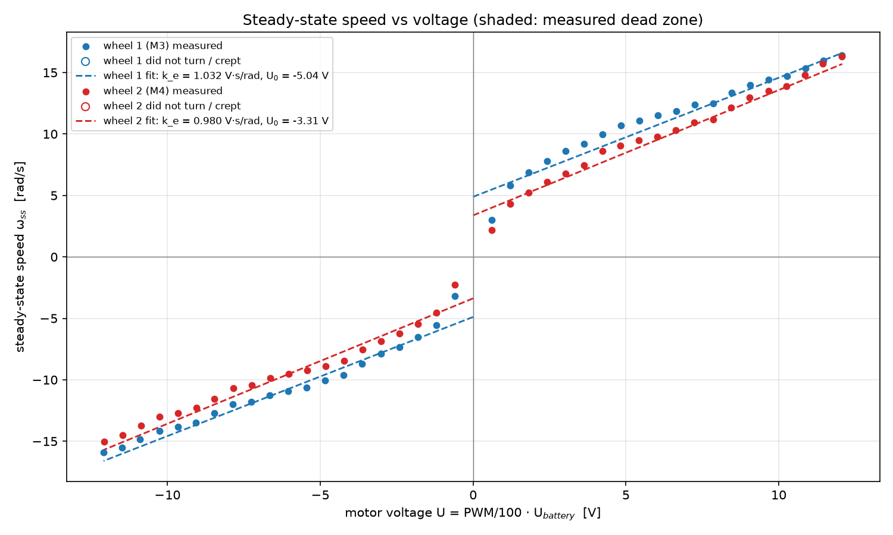
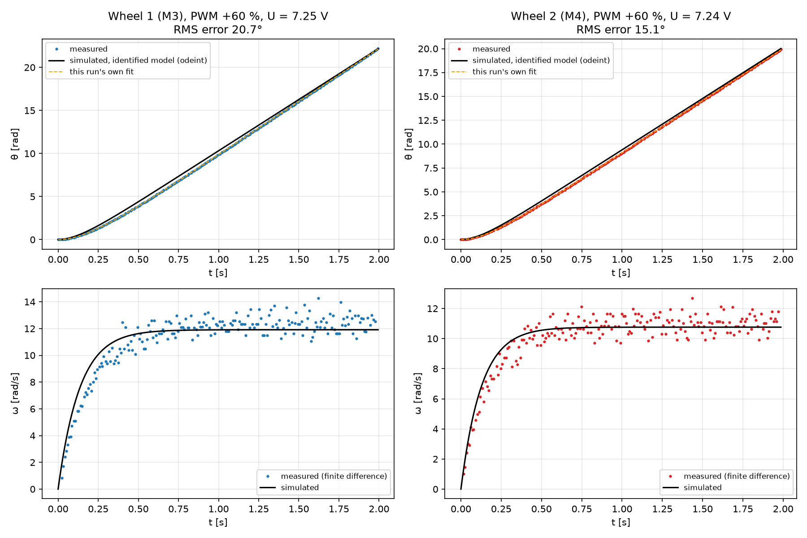
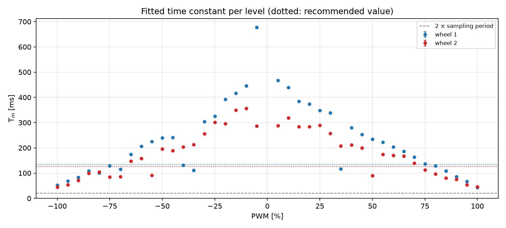
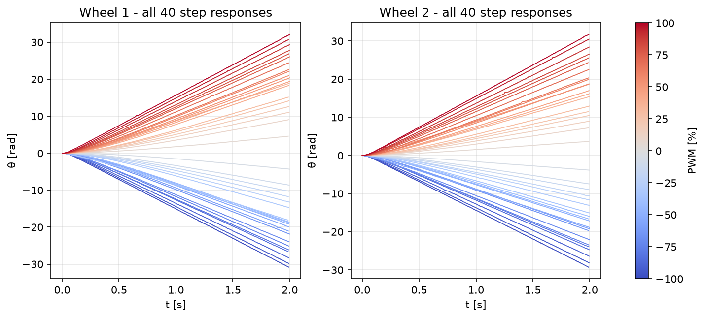

# Lab 5: Motor Parameter Identification

> **Data:** recorded on the robot on 2026-10-22 (80 runs, both drive wheels, wheels free, battery ≈ 12.1 V) and copied unedited into `motor_data/` (checksums match the robot's copies). Every table marked *auto* below is written by `motor_analysis.py --sim-pwm 60` from those files; the figures are in `figures/`.

## Overview

The goal is to identify the electromechanical time constant `T_m` and the back-EMF constant `k_e` of both drive motors of the TRIK robot (RK370 motors), and to check the identified model against a measurement in simulation. These parameters are reused in Week 6 (localization) and Week 7 (go-to-goal).

| File | Purpose |
|---|---|
| `motor_identification.qrs` | TRIK Studio project with the Python data-collection program (the code is stored in the project; open it and use **Run** / **Upload**) |
| `motor_identification.py` | The same program as a plain `.py` file, for reading and diffing |
| `motor_data/` | Raw robot files `wheel_<N>_v_<PWM>.txt`, exactly as the robot wrote them |
| `motor_analysis.py` | Offline identification: fits, `odeint` simulation, figures, tables in this report |
| `results/` | `step_fits.csv` (one row per run) and `parameters.json` (identified values) |
| `figures/` | Plots used below |

## Model

With the armature inductance neglected (the electrical time constant is much shorter than the mechanical one), a lightly loaded DC motor is a first-order system in angular velocity:

```
T_m · dω/dt + ω = U / k_e        dθ/dt = ω
```

For a voltage step `U` applied at `t = 0` from rest:

```
ω(t) = ω_ss (1 − e^(−t/T_m))                 ω_ss = U / k_e
θ(t) = ω_ss (t − T_m + T_m e^(−t/T_m))
```

The encoder measures `θ(t)`, so each step response gives `ω_ss` and `T_m`. `k_e` follows from how `ω_ss` grows with `U` over all levels. The dead zone (static friction) is added as an offset `U₀`:

```
ω_ss = (U − sgn(U)·U₀) / k_e      for |U| > U₀,   otherwise 0
```

## Experiment

**Setup.** The robot stands on a support with both drive wheels off the ground (`load: free_spin` in every file), so the wheels turn without load. The battery is charged before the series.

**Procedure** (`motor_identification.py`, one run for both wheels, about 5 minutes):

1. For wheel 1 (`M3`/`E3`), then wheel 2 (`M4`/`E4`), and every PWM level −100 … −5, +5 … +100 % (40 levels per wheel, 0 % skipped):
2. reset the encoder, wait 0.5 s with the motor off, and read the battery voltage at rest;
3. apply the PWM step (t = 0) and sample `(time stamp, encoder angle)` into a Python list every ≈ 5 ms for 2 s;
4. read the battery voltage **under load**, switch the motor off, and only then write the file;
5. let the wheel coast to a stop for 1 s.

**Design decisions.**

- **No file I/O while sampling.** Writing inside the loop stretches and jitters the sampling period (the course reference data was sampled every 20–61 ms because of it). The list is written after the motor is off.
- **Real time stamps.** Every sample carries its own `time.time()` stamp, so loop jitter does not distort the time axis.
- **Battery voltage per run, at rest and under load.** TRIK sets PWM, not volts, so `U = PWM/100 · U_battery`. The battery sags while the motor runs, so the analysis uses the loaded voltage.
- **Self-describing files.** Each header records the wheel, ports, PWM, both voltages, the load condition and the column format (`time_ms angle_deg`), so the analysis needs no outside notes.
- **Encoder direction is not "fixed" in the data.** On a differential drive one motor is mirrored, so positive PWM can give a falling encoder count on one side. The raw files stay as recorded; the analysis detects the sign per wheel and reports it.

## Analysis method

`motor_analysis.py` processes every file in `motor_data/`:

1. **Motion check.** A run counts as *still* if the wheel turned less than 5° or only crept slower than 0.2 rad/s (stick-slip). Still runs define the dead zone and are not fitted.
2. **Step fit.** `θ(t)` is fitted with `scipy.optimize.curve_fit`, with `T_m` bounded to 1 ms … 3 s (an unbounded fit collapses to `T_m → 0` on fast runs). The covariance gives a 1σ error. A `T_m` shorter than two sampling periods, at a bound, or with σ > 50 % is flagged as unreliable.
3. **Voltage.** `U = PWM/100 · U_battery, under load`.
4. **k_e and U₀.** One least-squares fit of `ω_ss = (U − sgn(U)·U₀)/k_e` over both directions, plus separate forward and reverse fits for comparison.
5. **Recommended T_m.** The median over reliable fits with |PWM| ≥ 30 % (the range the robot actually drives in).
6. **Simulation.** The identified model (one `k_e`, `U₀` and `T_m` per wheel, *not* the run's own fit) is integrated with `odeint` for the measured voltage and compared with the measured `θ(t)` and `ω(t)`.

## Data quality *(auto)*

<!-- AUTO:quality -->
| Wheel | Files | Samples per run (min / median) | Sampling period median / max [ms] | Battery at rest [V] | Battery under load [V] | Load |
|---|---:|---:|---:|---:|---:|---|
| 1 | 40 | 185 / 201 | 10.0 / 33 | 12.06 – 12.12 | 12.06 – 12.10 | free_spin |
| 2 | 40 | 198 / 201 | 10.0 / 37 | 12.04 – 12.09 | 12.02 – 12.09 | free_spin |
<!-- /AUTO:quality -->

## Identified parameters *(auto)*

<!-- AUTO:parameters -->
| Wheel | Ports | k_e [V·s/rad] | U₀ [V] | R² | k_e fwd / rev | Dead zone fwd / rev (PWM %) | T_m [ms] (median, |PWM| ≥ 30 %) | Encoder sign |
|---|---|---:|---:|---:|---:|---:|---:|---:|
| 1 | M3/E3 | **1.032** | -5.04 | 0.996 | 1.017 / 1.047 | none / none | **134** (44–338, n=30) | +1 |
| 2 | M4/E4 | **0.980** | -3.31 | 0.997 | 0.921 / 1.048 | none / none | **126** (44–257, n=30) | +1 |

k_e and U₀ come from one fit over both directions, ω = (U − sgn(U)·U₀)/k_e, using every level at which the wheel turned. A negative U₀ means the curve is steeper near zero than the line (no dead zone in the linear fit). The measured dead zone is the largest |PWM| at which the wheel did not turn (< 5° in the run) or only crept (< 0.2 rad/s, stick-slip).
<!-- /AUTO:parameters -->

### For Weeks 6–7 *(auto)*

<!-- AUTO:handoff -->
```python
# Lab 5 identified motor parameters (from motor_analysis.py)
K_E_M3 = 1.0319    # V*s/rad, wheel 1
U0_M3  = -5.044     # V, offset of the steady-state line
T_M_M3 = 0.1342    # s
ENC_SIGN_M3 = +1  # multiply encoder readings by this
K_E_M4 = 0.9804    # V*s/rad, wheel 2
U0_M4  = -3.310     # V, offset of the steady-state line
T_M_M4 = 0.1263    # s
ENC_SIGN_M4 = +1  # multiply encoder readings by this
```
<!-- /AUTO:handoff -->

## Steady-state speed vs voltage

Both wheels on the same axes, with the fitted `k_e` line and the measured dead zone shaded.



## Step response: measurement vs simulation

Top: measured angle, the `odeint` simulation of the identified model, and the run's own fit. Bottom: measured speed (finite difference over ±2 samples) against the simulated speed.



## Time constant across PWM levels





## T_m and ω_ss for every PWM level *(auto)*

<!-- AUTO:levels -->
| PWM % | U1 [V] | ω1 [rad/s] | T_m1 [ms] | U2 [V] | ω2 [rad/s] | T_m2 [ms] |
|---:|---:|---:|---:|---:|---:|---:|
| -100 | -12.09 | -15.90 | 53 ± 0 | -12.08 | -15.04 | 44 ± 0 |
| -95 | -11.49 | -15.51 | 69 ± 0 | -11.47 | -14.51 | 54 ± 0 |
| -90 | -10.89 | -14.83 | 84 ± 0 | -10.87 | -13.72 | 71 ± 0 |
| -85 | -10.25 | -14.19 | 109 ± 0 | -10.25 | -13.03 | 99 ± 0 |
| -80 | -9.66 | -13.83 | 100 ± 0 | -9.65 | -12.70 | 105 ± 0 |
| -75 | -9.08 | -13.47 | 129 ± 0 | -9.05 | -12.29 | 85 ± 1 |
| -70 | -8.46 | -12.74 | 116 ± 1 | -8.46 | -11.53 | 85 ± 1 |
| -65 | -7.86 | -11.97 | 175 ± 1 | -7.85 | -10.68 | 148 ± 0 |
| -60 | -7.25 | -11.81 | 207 ± 0 | -7.25 | -10.46 | 158 ± 0 |
| -55 | -6.65 | -11.25 | 225 ± 1 | -6.64 | -9.87 | 91 ± 1 |
| -50 | -6.04 | -10.93 | 239 ± 0 | -6.03 | -9.52 | 196 ± 0 |
| -45 | -5.44 | -10.62 | 241 ± 1 | -5.43 | -9.22 | 189 ± 1 |
| -40 | -4.84 | -10.04 | 131 ± 2 | -4.83 | -8.91 | 204 ± 1 |
| -35 | -4.24 | -9.60 | 111 ± 2 | -4.22 | -8.43 | 212 ± 0 |
| -30 | -3.63 | -8.70 | 304 ± 1 | -3.62 | -7.54 | 255 ± 1 |
| -25 | -3.02 | -7.89 | 325 ± 1 | -3.02 | -6.88 | 301 ± 1 |
| -20 | -2.42 | -7.35 | 392 ± 1 | -2.42 | -6.22 | 295 ± 1 |
| -15 | -1.81 | -6.52 | 416 ± 1 | -1.81 | -5.45 | 350 ± 1 |
| -10 | -1.21 | -5.56 | 445 ± 1 | -1.20 | -4.56 | 356 ± 1 |
| -5 | -0.60 | -3.19 | 677 ± 4 | -0.60 | -2.25 | 287 ± 1 |
| +5 | 0.60 | 3.00 | 468 ± 2 | 0.60 | 2.17 | 288 ± 2 |
| +10 | 1.21 | 5.83 | 439 ± 1 | 1.21 | 4.32 | 319 ± 1 |
| +15 | 1.81 | 6.87 | 384 ± 1 | 1.81 | 5.24 | 283 ± 1 |
| +20 | 2.42 | 7.78 | 374 ± 1 | 2.42 | 6.11 | 284 ± 1 |
| +25 | 3.02 | 8.60 | 348 ± 1 | 3.02 | 6.78 | 289 ± 1 |
| +30 | 3.62 | 9.18 | 338 ± 1 | 3.62 | 7.44 | 257 ± 1 |
| +35 | 4.23 | 9.99 | 117 ± 2 | 4.23 | 8.61 | 207 ± 1 |
| +40 | 4.83 | 10.70 | 280 ± 1 | 4.83 | 9.06 | 211 ± 1 |
| +45 | 5.43 | 11.10 | 253 ± 1 | 5.43 | 9.47 | 199 ± 0 |
| +50 | 6.04 | 11.53 | 235 ± 1 | 6.03 | 9.78 | 90 ± 1 |
| +55 | 6.64 | 11.86 | 222 ± 0 | 6.63 | 10.31 | 174 ± 0 |
| +60 | 7.25 | 12.37 | 204 ± 0 | 7.24 | 10.94 | 170 ± 0 |
| +65 | 7.85 | 12.50 | 186 ± 0 | 7.85 | 11.17 | 167 ± 1 |
| +70 | 8.45 | 13.37 | 163 ± 0 | 8.44 | 12.16 | 140 ± 1 |
| +75 | 9.06 | 13.99 | 137 ± 0 | 9.05 | 12.98 | 113 ± 0 |
| +80 | 9.66 | 14.40 | 129 ± 0 | 9.66 | 13.49 | 97 ± 0 |
| +85 | 10.28 | 14.72 | 108 ± 0 | 10.24 | 13.87 | 81 ± 0 |
| +90 | 10.88 | 15.35 | 86 ± 0 | 10.85 | 14.80 | 76 ± 0 |
| +95 | 11.46 | 15.99 | 68 ± 0 | 11.45 | 15.73 | 53 ± 0 |
| +100 | 12.06 | 16.42 | 44 ± 0 | 12.06 | 16.32 | 46 ± 0 |

ω is the fitted steady-state speed; T_m ± 1σ from the fit covariance. ⚠ = T_m not resolved (shorter than two sampling periods, at the search bound, or σ > 50 %); those levels are excluded from the recommended T_m.
<!-- /AUTO:levels -->

## Key numbers *(auto)*

<!-- AUTO:key_numbers -->
- Wheel 1: forward vs reverse k_e differ by 2.9 % (1.017 vs 1.047 V·s/rad).
- Wheel 1: T_m ranges 44–338 ms over |PWM| ≥ 30 % — the linear model assumes one constant.
- Wheel 1: steady-state line fit R² = 0.996, RMS residual 0.72 rad/s.
- Wheel 2: forward vs reverse k_e differ by 13.9 % (0.921 vs 1.048 V·s/rad).
- Wheel 2: T_m ranges 44–257 ms over |PWM| ≥ 30 % — the linear model assumes one constant.
- Wheel 2: steady-state line fit R² = 0.997, RMS residual 0.61 rad/s.
- PWM +50 %: wheel 1 11.53 rad/s, wheel 2 9.78 rad/s; wheel 2 is 15.2 % slower than wheel 1. With the same PWM on both motors the robot would turn ≈ 48.5° per metre (track width W = 0.194 m).
- PWM +100 %: wheel 1 16.42 rad/s, wheel 2 16.32 rad/s; wheel 2 is 0.6 % slower than wheel 1. With the same PWM on both motors the robot would turn ≈ 1.8° per metre (track width W = 0.194 m).
- PWM -50 %: wheel 1 -10.93 rad/s, wheel 2 -9.52 rad/s; wheel 2 is 12.9 % slower than wheel 1. With the same PWM on both motors the robot would turn ≈ 40.8° per metre (track width W = 0.194 m).
- PWM -100 %: wheel 1 -15.90 rad/s, wheel 2 -15.04 rad/s; wheel 2 is 5.4 % slower than wheel 1. With the same PWM on both motors the robot would turn ≈ 16.5° per metre (track width W = 0.194 m).
- Simulation check, wheel 1 at PWM +60 %: RMS angle error 20.7°, angle after 2 s off by -0.1 %.
- Simulation check, wheel 2 at PWM +60 %: RMS angle error 15.1°, angle after 2 s off by +0.4 %.
<!-- /AUTO:key_numbers -->

## Discussion

The linear model fits the upper PWM range well but fails near zero. Neither motor has a dead zone: both wheels already turn at 2–3 rad/s at 5 % PWM (≈ 0.6 V), about four to five times the ≈ 0.6 rad/s that ω = U/k_e predicts, so ω_ss(U) is concave and the best straight line needs a negative offset (U₀ ≈ −5 V for M3, −3 V for M4). The most likely reason is that, with a free-spinning wheel, the PWM driver does not act like an average voltage of PWM · U_battery at low duty, so `U` is not the true motor voltage there. `T_m` is not constant either: it falls from 300–450 ms at low PWM to ≈ 45 ms at ±100 % (median 134 ms for M3 and 126 ms for M4 over |PWM| ≥ 30 %), and in four runs the start-up was clearly faster than at the neighbouring levels, so the identified model reproduces the speed reached but only roughly the acceleration (at +60 %: final angle within 0.4 %, RMS angle error 15–21°). The motors differ most at mid speed: M4 is 13–15 % slower than M3 at ±50 % PWM but only 0.6–5 % slower at ±100 %, and M4's forward and reverse k_e differ by 14 % (M3: 3 %). Encoder odometry measures the real wheel rotation, so this mismatch does not corrupt the dead-reckoning itself, but with equal PWM the robot will curve towards the M4 side by roughly 40–50° per metre at ±50 % PWM (for a 19.4 cm track), so next week the wheel speeds should be closed-loop per wheel, or at least feed-forward from the measured ω_ss(PWM) table rather than from a single k_e.

## Validation of the pipeline

The collector and the analysis were checked in four steps, the first three before the robot run:

- **Dry run with a simulated motor.** The unmodified `motor_identification.py` was run on a PC against a first-order motor with known parameters, a dead zone, 1° encoder quantisation, loop jitter, battery sag and one mirrored encoder. The analysis recovered:

  | Wheel | k_e true → identified | U₀ true → identified | T_m true → identified | Encoder sign |
  |---|---|---|---|---|
  | 1 (M3) | 0.780 → 0.780 | 0.60 → 0.60 V | 60 → 58 ms | +1 detected |
  | 2 (M4) | 0.820 → 0.821 | 0.80 → 0.80 V | 70 → 68 ms | −1 detected |

  The small low bias in `T_m` comes from the time stamp being taken just before each encoder read.
- **Course reference data** (5 wheels, `05_Motor_parameter_identification/src/motor_data`, older angle-first format, 27 ms sampling). The analysis read it unchanged and produced R² ≈ 0.99 line fits. It flagged the fast high-PWM `T_m` fits as unresolved at that sampling rate, and found wheel 1's forward dead zone (≤ 10 % PWM).
- **TRIK Studio 2026.2.** `motor_identification.qrs` opens with the program in its Python tab (byte-identical to `motor_identification.py`) and runs in the 2D simulator: the console prints one line per level, and the files are written with the expected header and data. The simulator has no battery model, so it logs `nan` voltages; the analysis refuses such files with a clear message instead of producing wrong voltages. The first simulator run is what exposed this: `brick.battery()` returns nothing there, so the battery read is now fault-tolerant.
- **Real robot run (2026-10-22).** All 80 runs completed with ≈ 200 samples each (median sampling period 10 ms, slower than the 5 ms target because each encoder read and `script.wait` take time on the robot) and a battery voltage of ≈ 12.1 V logged for every step.

## How to reproduce

On the robot (TRIK Studio, robot connected):

1. Put the robot on a stand, wheels free. Charge the battery.
2. Open `motor_identification.qrs` and **click the Python tab** (shown as `lastCode.py`) before pressing Run. With the empty block-diagram tab active, TRIK Studio tries to run the diagram and reports "No entry point found".
3. Run it on the robot. Watch the console: about 200 samples per level and a real battery voltage. Wheel 1 (M3) runs first.
4. The program writes `motor_data/` into the robot's script folder (`/home/root/trik/scripts/motor_data`). Copy the `wheel_*_v_*.txt` files into `Lab5/motor_data/` without changing anything, e.g. `scp root@<robot IP>:/home/root/trik/scripts/motor_data/wheel_*_v_*.txt motor_data/` (this run: robot at 192.168.50.254).

On the PC (needs `numpy`, `scipy`, `matplotlib`; works in Colab too):

```bash
py motor_analysis.py
```

This writes `results/`, `figures/` and the *auto* sections of this report. This report was generated with `py motor_analysis.py --sim-pwm 60`. Options: `--sim-pwm` chooses the simulated step, `--fit-min-pwm 20` restricts the `k_e` fit, and `--track-width 0.194` sets the wheel spacing used for the drift estimate (measure your robot).
